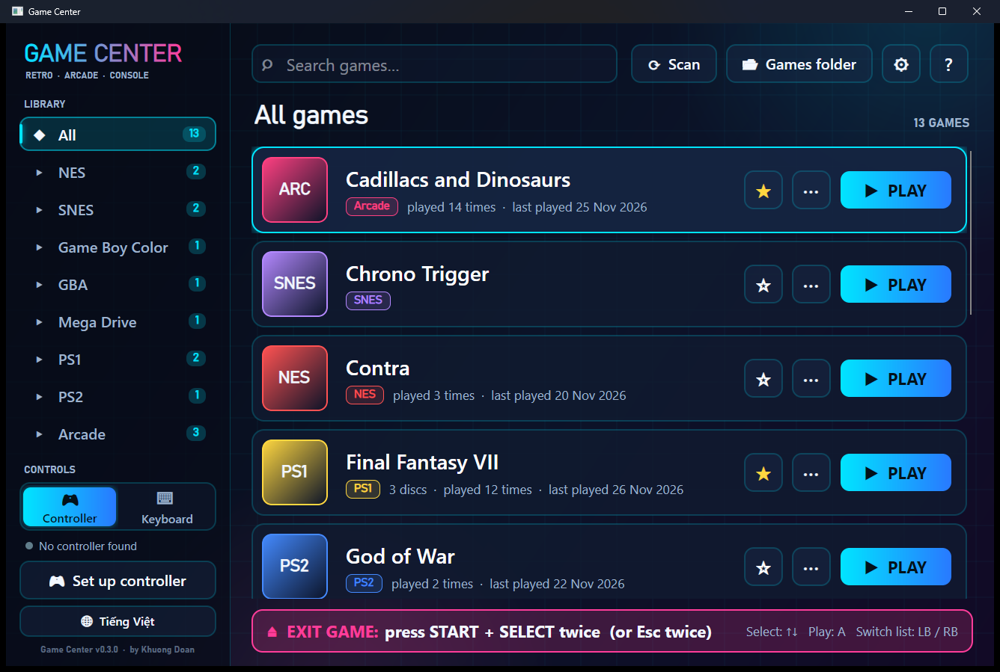
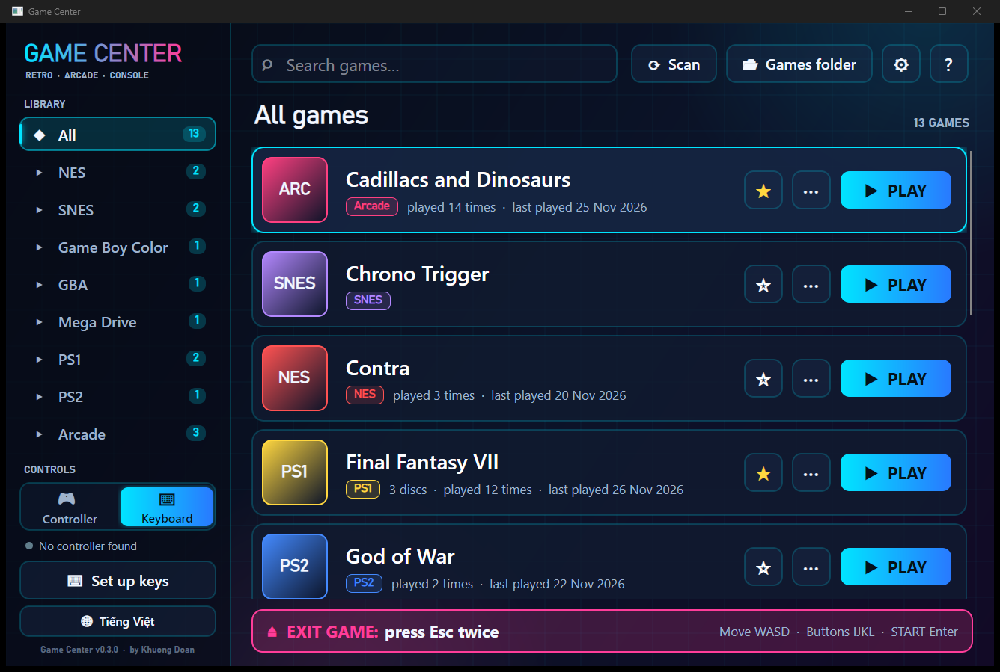
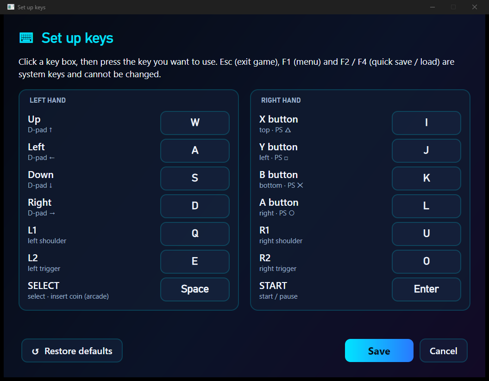

# Game Center: a simple retro game launcher for seniors

[Tiếng Việt](README.md) · **English**

[](https://github.com/2ez4gcx/game-center-retro-launcher/releases/latest)
[](https://github.com/2ez4gcx/game-center-retro-launcher/actions/workflows/release.yml)


**Game Center** is a **free** emulator frontend for **Windows, macOS and Linux** that lets anyone play classic console games: PlayStation (PS1), PlayStation 2 (PS2), NES, SNES, Game Boy, Game Boy Advance, Sega Mega Drive / Genesis, Master System, Game Gear and arcade games (Neo Geo, Capcom CPS1/CPS2, PGM: King of Fighters, Metal Slug, Cadillacs and Dinosaurs...). It is designed for older players and anyone who is not comfortable with computers: large text, big buttons, controller or keyboard, nothing to configure. Under the hood it runs RetroArch, but the player never has to deal with it. The interface is available in **English and Vietnamese** (click the 🌐 button in the bottom-left corner to switch).

```text
Install → Next → Finish → Copy games → Play
```



## Features

- **Install and play:** the installer ships RetroArch and 8 emulator cores; nothing else to download or configure.
- **Automatic game detection:** copy games into the `Games` folder and Game Center reads the file content to work out which console each game is for (including `.zip`, `.chd`, `.pbp` and loose `.bin` files), telling PS1 and PS2 discs apart.
- **Arcade games:** copy an arcade game's zip file in and play; the app shows the full name (`dino.zip` → Cadillacs and Dinosaurs) and warns up front about a missing Neo Geo BIOS, a missing parent set or a ROM set from the wrong version.
- **Multi-disc games:** Final Fantasy VII, Metal Gear Solid, The Legend of Dragoon... are merged into one entry, discs can be swapped while playing, and all discs share one memory card.
- **Saves are never lost:** each game's saves are backed up every time you play (the last 10 are kept) and can be restored from inside the app; renaming a game file keeps its saves.
- **Hard to press the wrong button:** exiting a game takes two presses, and Game Center asks in plain words whether to save your place.
- **Easy to find games:** accent-insensitive search, favorites, recently played.

## Download

Get the latest version from [Releases](https://github.com/2ez4gcx/game-center-retro-launcher/releases/latest). Every build already includes .NET 8, RetroArch and the emulator cores; nothing else to install. **No games or BIOS files are included.**

| OS | File | How to install |
|---|---|---|
| **Windows** 10/11 (64-bit) | `GameCenter-Setup-x.y.z.exe` | Run it, click Next → Finish. Pick **English** on the first screen and Game Center starts in English |
| **macOS** Apple chip (M1–M4) | `GameCenter-x.y.z-macos-arm64.dmg` | Open it and drag **Game Center** into **Applications** |
| **macOS** Intel | `GameCenter-x.y.z-macos-x86_64.dmg` | Same as above |
| **Linux** (64-bit) | `GameCenter-x.y.z-x86_64.AppImage` | Make it executable (`chmod +x`), then double-click |

**Windows:** no admin rights needed, installs to `C:\GameCenter` by default (another drive can be chosen). Games, saves and BIOS live inside the install folder. Uninstalling **does not delete** games or saves.

> ⚠️ **The macOS and Linux builds have not been tested on real machines yet.** They build and pass the automated tests on both systems. If something goes wrong, please [open an issue](https://github.com/2ez4gcx/game-center-retro-launcher/issues) and attach `~/GameCenter/Logs/gamecenter.log`. The Windows build is fully tested.

**macOS / Linux:** games, saves and BIOS live in `~/GameCenter`. On macOS, the first time, **right-click → Open** because the app is not notarized by Apple.

## Supported consoles

| Console | Formats | Core | Core license |
|---|---|---|---|
| NES (Famicom) | `.nes`, `.zip` | FCEUmm | GPLv2 |
| SNES (Super Famicom) | `.sfc`, `.smc`, `.zip` | Snes9x | Non-commercial |
| Game Boy / Game Boy Color | `.gb`, `.gbc`, `.zip` | Gambatte | GPLv2 |
| GBA (Game Boy Advance) | `.gba`, `.zip` | mGBA | MPL 2.0 |
| Sega Master System / Game Gear | `.sms`, `.gg`, `.zip` | Genesis Plus GX | Non-commercial |
| Sega Mega Drive / Genesis | `.md`, `.gen`, `.smd`, `.bin`, `.zip` | Genesis Plus GX | Non-commercial |
| PS1 (PlayStation) | `.cue`, `.bin`, `.pbp`, `.chd`, `.ccd`, `.m3u` | Beetle PSX HW | GPLv2 |
| **PS2** (PlayStation 2) | `.iso`, `.chd`, `.cso`, `.zso`, `.cue`/`.bin`, `.m3u` | LRPS2 | GPLv3 |
| **Arcade** (Neo Geo, Capcom CPS1/2/3, PGM, Cave, Konami, Sega...) | `.zip`, `.7z` (FinalBurn Neo ROM sets) | FinalBurn Neo | Non-commercial |

PS1 games run without a BIOS (OpenBIOS). Adding a BIOS you backed up yourself to the `BIOS` folder improves compatibility.

**PS2 requires a BIOS** dumped from your own PS2: copy the BIOS file (usually `SCPH-xxxxx.bin`, 4 MB, any name works) straight into the `BIOS` folder and Game Center moves it to where the core expects it (`BIOS/pcsx2/bios/`). PS2 needs a fairly powerful computer (a 4-core CPU and a dedicated or recent built-in GPU) and a controller with analog sticks. PS2 on Apple-chip Macs is untested.

**Arcade games:** copy the `.zip` file into `Games` (or `Games/Arcade`) and **keep its file name**, which is the game code (`dino.zip`, `kof98.zip`): the emulator recognizes games by file name. Game Center shows the full name and checks the ROM set against FinalBurn Neo's list:

- Neo Geo games (King of Fighters, Metal Slug...) need the BIOS `neogeo.zip` and PGM games (Knights of Valour...) need `pgm.zip`: copy them into the `BIOS` folder as zip files. If one is missing, Game Center says so instead of opening an error screen.
- Variants (Japanese versions, hacks such as `kof97pls.zip`) need the original game's file (`kof97.zip`) in the same folder.
- MAME ROM sets from other versions may be missing files: Game Center flags this in the list and asks before playing. ROM sets made for FinalBurn Neo are recommended.
- Renamed files (`King of Fighters 98.zip`): Game Center recognizes them by content and tells you the right name to use.
- While playing: press **SELECT** (keyboard: Space) to insert a coin, then **START** (Enter). The first time you play each game, Game Center reminds you how.

## How is Game Center different from RetroArch?

Game Center **does not replace** RetroArch; it is a simple layer on top. RetroArch and its cores still run the games; Game Center handles everything else so the player never has to touch RetroArch.

| | RetroArch on its own | Game Center |
|---|---|---|
| **Role** | Multi-system emulator that runs games | Launcher: manages games, calls RetroArch to play |
| **Setup** | Download each core, set up folders, BIOS, controllers yourself | Installer ships RetroArch, 8 cores and the configuration |
| **Adding games** | Scan or build playlists in the menu, pick the right core | Copy into `Games`; the console is detected from the file content |
| **PS1 / PS2** | Handle `.cue` files, write `.m3u` for multi-disc games, place the PS2 BIOS yourself | Tells PS1 and PS2 discs apart, merges discs, creates `.cue` for loose `.bin`, creates `.m3u`, places the PS2 BIOS |
| **Arcade** | Pick the core and place the BIOS yourself; an incomplete ROM set only shows an English error once the game opens | Shows full names, warns up front about a missing BIOS / parent set / wrong version, explains how to insert a coin |
| **Interface** | Many nested menus, small text, hundreds of options | One screen, large text, a "Play" button |
| **Controls** | Map buttons yourself; default hotkeys are easy to hit by accident | WASD/IJKL keys out of the box, risky hotkeys disabled, simple key-mapping window |
| **Exiting a game** | Need to know the key combo or use the menu | Always shown on screen; press twice to exit so a slip does not lose progress |
| **Save states** | Manual, or silent auto-save | Asks when you exit and when you come back, in plain words |
| **Extras** | Available, deep in the menus | Favorites, recently played, accent-insensitive search, save backup |

## Usage

**Adding games:** copy them into the `Games` folder; everything in one place is fine. Game Center recognizes the console from the file content and shows new games after a few seconds.

- `.cue` + `.bin` appear once; multi-disc games (including loose `.chd`, `.iso` named `(Disc 1)`, `(Disc 2)`, or one folder per disc such as `The Legend of Dragoon (Disc 1)/`, `(Disc 2)/`) are merged, discs can be changed while playing, and all discs share one memory card. Discs with different names that cannot be merged automatically (for example a translated disc 1 with original later discs): press **⋯ → Add another disc** on disc 1 and choose the next disc.
- PS1 vs PS2 discs are told apart by their content (`SYSTEM.CNF`), no need to sort them into folders.
- `.bin` / `.rom` without `.cue`: detected as a PS1 / PS2 disc or a cartridge ROM (NES, Game Boy, GBA, Mega Drive, Master System...) from its header.
- `.zip` with several ROMs: each ROM becomes a game.
- Arcade games: each `.zip` / `.7z` file (named after the game code) is one game, see [Supported consoles](#supported-consoles).
- Files that cannot run (`.7z`, `.rar`, multi-part archives, disc games inside `.zip`, consoles not supported yet...) appear under **Not recognized** with instructions. All cases are described (in Vietnamese) in [docs/nhan-dien-file-nen.md](docs/nhan-dien-file-nen.md).
- BIOS files copied into `Games` by mistake are moved to the `BIOS` folder automatically.

**Controls:** choose **Controller** or **Keyboard** in the bottom-left corner; the keyboard always works alongside a controller.

| Controller | Keyboard (default) |
|---|---|
| D-pad ↑ ← ↓ → | W A S D |
| X / Y / B / A | I / J / K / L |
| L1 / L2 | Q / E |
| R1 / R2 | U / O |
| START / SELECT | Enter / Space |

Change keys with **Set up keys** (click a box, then press the new key).

| Keyboard mode | Set up keys |
|---|---|
|  |  |

**Exiting a game:** press **START + SELECT** on the controller, or **Esc** on the keyboard, **twice in a row**. The first press only shows "Press again to quit...", so a single slip never ends your game. **F1** opens the emulator menu (changing discs…), **F2 / F4** quick save / load. The emulator menu uses the same language as Game Center.

**Saves:**
- In-game saves (memory cards, cartridge saves) are always kept and written to disk every 10 seconds.
- When you exit, Game Center asks whether to **save your place**; next time it asks whether to **continue** or **start over**. This can be turned off in Settings.
- **Settings → Back up saves** zips all saves (including PS2 memory cards) into a dated file.
- Every time you click Play, Game Center backs up that game's saves (the last 10 are kept). If a save gets damaged: **⋯ → Restore an older save** and pick a point in time.
- Renaming game files, adding more discs to a multi-disc game, or changing the data folder: your existing saves follow automatically. "Continue" never overwrites a newer in-game save. Details and test procedure (Vietnamese): [docs/bao-toan-save.md](docs/bao-toan-save.md).

**Using an existing PS1 memory card save** (from another emulator or downloaded):

1. Close the game (RetroArch only reads memory cards when a game starts).
2. **Settings → Open saves folder**, go into **`Beetle PSX HW`**:
   - Windows: `<install folder>\Saves\Beetle PSX HW\` (default `C:\GameCenter\Saves\Beetle PSX HW\`)
   - macOS / Linux: `~/GameCenter/Saves/Beetle PSX HW/`
3. If a `.srm` file with the same name exists, copy it somewhere else as a backup.
4. Copy the memory card file in and **rename it to exactly the game's file name** (original name, including "(USA)") with the `.srm` extension:

   | Game runs from | Save file name |
   |---|---|
   | `Yu-Gi-Oh! Forbidden Memories (USA).bin` or `.cue` | `Yu-Gi-Oh! Forbidden Memories (USA).srm` |
   | Multi-disc: `Metal Gear Solid (Disc 1).cue`, `(Disc 2).cue` | `Metal Gear Solid.srm` (shared by all discs) |
   | `.chd` / `.pbp` | that file name + `.srm` |

5. Start the game and go to the Load screen: the save is on Memory Card 1.

| Memory card format | From | How to use |
|---|---|---|
| `.mcr`, `.mcd`, `.mc`, `.srm` (exactly 128 KB) | ePSXe, DuckStation, PCSX, RetroArch | Just rename to `.srm` |
| `.gme` | DexDrive | Convert first with [MemcardRex](https://github.com/ShendoXT/memcardrex) |
| `.psv`, `.mcs`, `.psx` | PS3, single-game saves | Use MemcardRex to copy into an empty card, save as `.mcr`, then rename |

A ready-to-use file must be exactly **131,072 bytes (128 KB)**.

**Using the launcher with a controller:** ↑↓ choose a game, A play, LB/RB switch list, Y favorite, X more options, START settings, SELECT help.

## FAQ

### Is Game Center free?

Yes. Completely free, no ads, no paid features.

### Does it come with games?

No. Game Center includes no games and no BIOS files. Use games and BIOS files you legally own, for example backups of your own discs and cartridges.

### Do PS1 games need a BIOS? What about PS2?

PS1 games run without one: copy them in and play. PS2 requires a BIOS dumped from your own PS2, see [Supported consoles](#supported-consoles).

### Can I play multi-disc PS1 games?

Yes. Put the discs in the same place (or one folder per disc) and Game Center merges them into one game. When the game asks for the next disc, press **F1** → **Disc Control** to swap it; step-by-step instructions are behind the **?** button in the app. The memory card is shared by all discs.

### Can I play arcade games?

Yes, with the bundled FinalBurn Neo emulator: King of Fighters, Metal Slug, Cadillacs and Dinosaurs, Knights of Valour, Street Fighter, Captain Commando... Copy the game's zip file into `Games` and keep its file name. Neo Geo games also need `neogeo.zip` and PGM games need `pgm.zip` in the `BIOS` folder. Details under [Supported consoles](#supported-consoles).

### What about `.7z` or `.rar` files?

They show up under **Not recognized** with instructions: extract them, then copy the game into `Games`. A `.zip` holding a cartridge game (NES, SNES, Game Boy, GBA, Mega Drive...) plays as is, no need to extract it. Arcade games stay as `.zip` / `.7z` files: do not extract them.

### Can I bring my saves from ePSXe, DuckStation or RetroArch?

PS1 memory card saves can be reused: see **Using an existing PS1 memory card save** under [Usage](#usage).

### Will it run on an old or slow computer?

Games for the older consoles (NES, SNES, Game Boy, GBA, Mega Drive), most arcade games and PS1 are very light. PS2 is much more demanding: a 4-core CPU and a dedicated or recent built-in graphics chip are recommended.

### How is it different from RetroArch?

Game Center is a simple layer on top of RetroArch, see the [comparison table](#how-is-game-center-different-from-retroarch).

## Development

Requires the .NET 8 SDK.

```
dotnet test
dotnet run --project src/GameCenter.Desktop
```

To use a separate data folder while testing, set the `GAMECENTER_DATA_DIR` environment variable.

| Folder | Contents |
|---|---|
| `src/GameCenter.Core` | Game scanning and detection, SQLite, `retroarch.cfg` generation, key mapping, save states, launching RetroArch |
| `src/GameCenter.Core/Localization/Lang` | UI strings `vi.json`, `en.json`. To add a language, add `<code>.json` with the same keys (tests check for missing keys and placeholders) |
| `src/GameCenter.Desktop` | Avalonia UI (Windows / macOS / Linux), controller input via SDL2 |
| `tests/GameCenter.Tests` | Tests |
| `Defaults/` | `platforms.json` (core per console), `retroarch-base.cfg` |
| `Licenses/` | Licenses for Game Center, RetroArch and each core |
| `installer/` | Windows installer (Inno Setup); writes the chosen language to `Defaults/installer.ini` |
| `tools/package-linux.sh`, `tools/package-macos.sh` | AppImage (Linux) and .dmg (macOS) packaging |
| `.github/workflows/release.yml` | Tests on 3 OSes; pushing a `v*` tag builds packages and drafts a Release |
| `tools/fetch-retroarch.ps1` | Downloads RetroArch, cores and their licenses into the publish folder |
| `src/GameCenter.Core/Arcade` | FinalBurn Neo arcade game list (`fbneo.dat.gz`), ROM set / BIOS / parent checks |
| `tools/update-fbneo-dat.ps1` | Rebuilds the arcade game list from FinalBurn Neo's DAT files |

Release:

```
./build.ps1                                                   # test + self-contained publish (bundles .NET 8)
./tools/fetch-retroarch.ps1 -Version 1.22.2                   # RetroArch + cores + licenses
./tools/update-fbneo-dat.ps1                                   # arcade game list matching the FBNeo core just downloaded
./tools/e2e-test.ps1 -AppDir ./publish/GameCenter             # tests with the real RetroArch (saves, multi-disc)
& "C:\Program Files\Inno Setup 7\ISCC.exe" installer\GameCenter.iss
```

Before releasing: write the release notes `docs/phat-hanh/v<version>.md` (the release job uses them), do a packaging dry run (**Actions → build → Run workflow**: packages for 3 OSes and an installer test on a clean Windows machine), run `e2e-test.ps1` and go through the manual checklist in [docs/bao-toan-save.md](docs/bao-toan-save.md) (section 4.3).

Linux / macOS (run on that OS, or let GitHub Actions build on tag push):

```
bash tools/package-linux.sh 1.22.2
bash tools/package-macos.sh arm64 1.22.2      # or x86_64
```

Detailed design (Vietnamese): [GAME_CENTER_IMPLEMENTATION.md](GAME_CENTER_IMPLEMENTATION.md).

## Android version (experimental)

This branch adds an experimental Android version that has **not been released**. Unlike the desktop version it does not use RetroArch: the emulator cores are inside the APK and run in the app itself through [LibretroDroid](https://github.com/Swordfish90/LibretroDroid), so it is still "install and play".

| Console | Core on Android | Status |
|---|---|---|
| NES, SNES, Game Boy / Color, Mega Drive, Master System, Game Gear | same as desktop | Packaged, not yet tried with real games |
| GBA | mGBA | Runs on a real device |
| PS1 | PCSX ReARMed (instead of Beetle PSX HW, because the app only has OpenGL ES) | Runs on a real device, no BIOS needed |
| Arcade | FinalBurn Neo | Runs on a real device |
| PS2 | Play! (emulates the BIOS itself, no BIOS file needed) | Shows a picture and runs on a real device; speed and per-game compatibility not evaluated. No "save my place", only in-game memory card saves |
| PSP | PPSSPP | Packaged, only disc detection is tested; not yet run with a real game. Android only |

Done: automatic game detection, accent-insensitive search, favorites, recently played, rename, choose console, manual disc merging, restoring older saves, save backup, Vietnamese / English, touch buttons (portrait and landscape) with a virtual analog stick for PS2 / PSP, a hide-buttons toggle and ×2 fast-forward, controller support on the main screen too, press-twice-to-quit, "save my place" on exit, in-game menu (change disc, quit).

By default the games folder lives in `Android/data/com.khuongdoan.gamecenter/files/Games`. **Settings** has a button to switch to a `GameCenter` folder right in internal storage (easier to copy games into; requires turning on file access when Android asks); existing games and saves are moved along.

Missing: cover pictures. Not tried: a physical controller (only simulated key presses so far), Android TV.

Build (Windows; needs the .NET 10 SDK with the `android` workload, the Android SDK + NDK, and JDK 17):

```
cd android; ./gradlew :player:dist; cd ..      # game screen (Kotlin) → android/dist/*.aar
./tools/fetch-android-cores.ps1                # download the Android libretro cores
dotnet build src/GameCenter.Android -c Debug -t:Install
```

| Folder | Contents |
|---|---|
| `src/GameCenter.Android` | Avalonia UI for Android, reusing `GameCenter.Core` |
| `android/player` | Game screen (Kotlin + LibretroDroid): runs the core, touch buttons, saving, in-game menu |
| `tools/fetch-android-cores.ps1` | Downloads the cores from the libretro buildbot into `src/GameCenter.Android/cores/` |

`GameCenter.Android` is not in `GameCenter.sln` yet, so `dotnet test` and the current CI do not need the Android workload. Because it uses LibretroDroid (GPL-3.0), the Android version is released under GPL-3.0: see `Licenses/Android/`.

## License

Game Center is free, with no ads and no paid features. RetroArch and each core keep their own licenses (see `Licenses/`). Snes9x, Genesis Plus GX and FinalBurn Neo only allow non-commercial distribution. Game Center is not an official product of Sony, Nintendo, Sega, SNK, Capcom or any other game company. No games or BIOS files are included.

---

Developed by **Khuong Doan**: <https://khuongdoan.com/>
